# Handling the monitor

Every picture on this page is a render, not a photograph: the T-Display's panel is
wired without MISO, so nothing can be read back off it. They are drawn by
[`screens/render.py`](screens/render.py) from the sketch's own font and its own
geometry constants, which is close enough to trust for layout and colour — but a
screen that changes in the sketch without someone re-running that script will go
quietly out of date here.

The words on screen are German, because the vehicle and its rider are.

## The two buttons

| | |
|---|---|
| short press | a step: page, move, change by 0.1 |
| long press **A** (right) | go in, choose, confirm |
| long press **B** (left) | go back out |

**A is forwards, B is back.** The menu travels right under A, a selection travels
down, a value goes up. Nothing repeats and nothing needs both buttons at once.

Hold a button for a moment and the symbols along the bottom edge show what letting go
would *not* do and holding on *will*. Let go early and nothing happens.

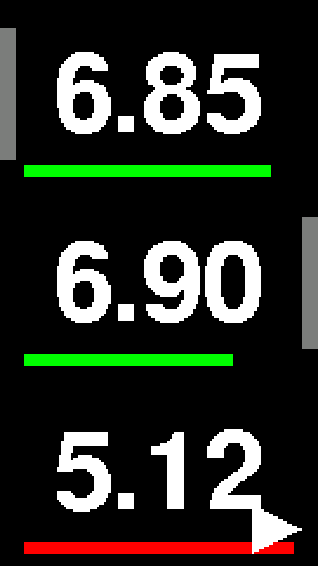

Those symbols mean the same thing wherever they appear:

| | |
|---|---|
| ◀ ▶ | go back out · go in |
| ✕ ✓ | leave it · do it |
| − + | down by 0.1 · up by 0.1 |
| 🗑 | delete, and then confirm with the other button |

 

## The readings

Three wheels, stacked the way the vehicle looks from above: front left on top, front
right in the middle, rear at the bottom. The two front tiles carry a grey mark on
their **outer** edge — that is what tells them apart once they are no longer side by
side. Under each reading, a bar for that sensor's battery.

| | | | |
|---|---|---|---|
| 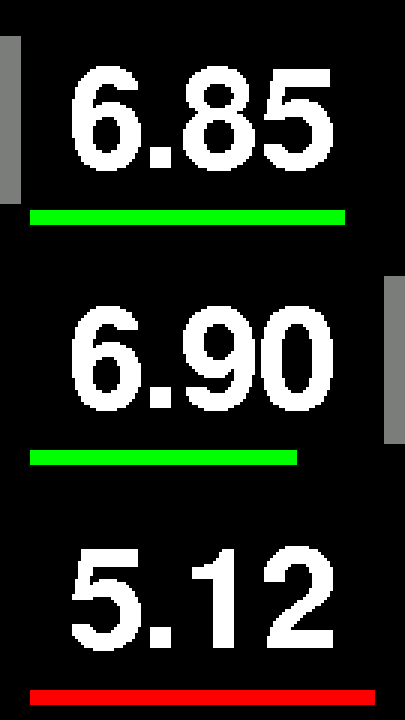 | 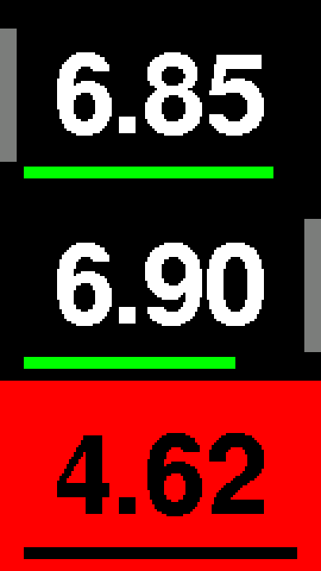 | 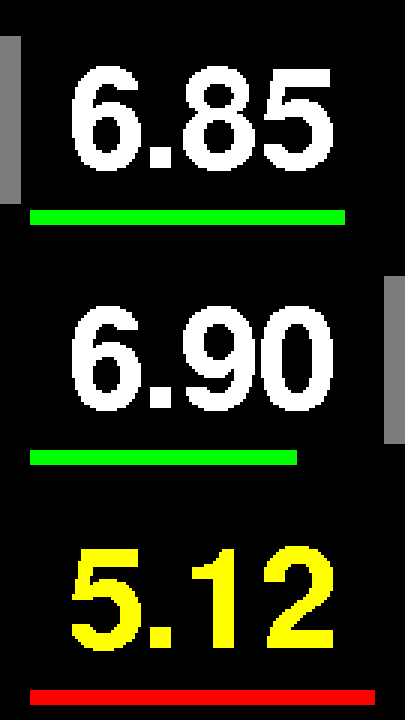 | 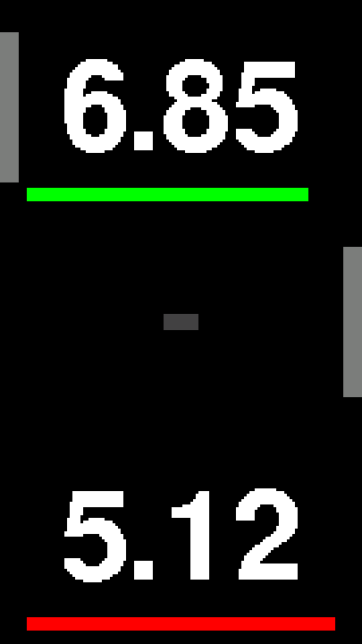 |
| Everything above its threshold. | Below the threshold: the tile inverts and flashes red until the tyre is seen to. | Amber: a slow puncture. Not below the threshold yet, but losing air faster than the weather explains. | A dash, and the battery bar gone: that sensor has said nothing for ten seconds. A silent sensor is never shown as "fine". |

**B** pages through the other things a sensor knows; **A** goes back to the pressure.
Nothing times out quickly — a page stays for three minutes.

| | | |
|---|---|---|
| 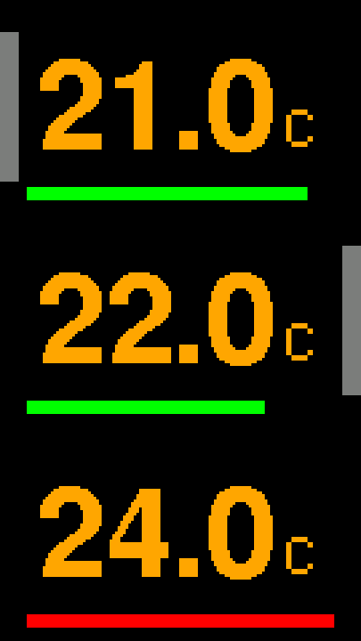 | 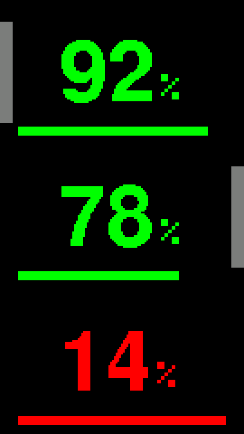 | 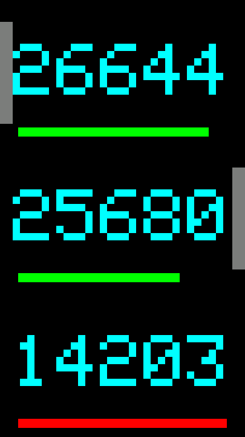 |
| Tyre temperature, in orange. A wheel in the sun reads several degrees above one in the shade. | Battery per sensor. Below 20 % the bar goes full width and red, because a bar drawn to length is the one you cannot see exactly when it matters. | The engraved serial, in cyan — the number on the sensor body, for matching a reading to a valve. |

The panel goes dark after a minute without a press and comes back on either button,
with that press spent doing so. An alarm or a slow puncture lights it by itself and
holds it lit until the cause is gone.

**A held** opens the setup menu.

## The menu

One page per item, scrolling sideways; the dots say where you are in the ring. **A**
steps forward, **B** back, **A held** goes in, **B held** leaves.

| | | | |
|---|---|---|---|
| 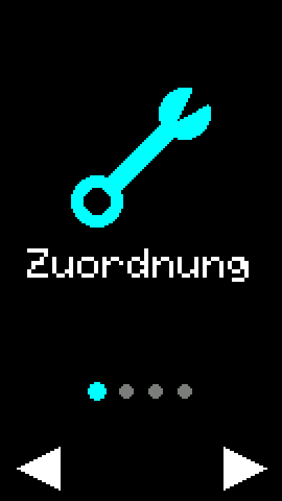 | 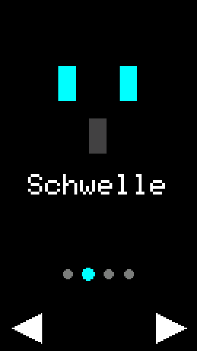 | 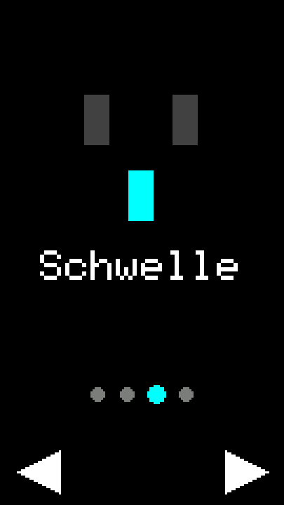 | 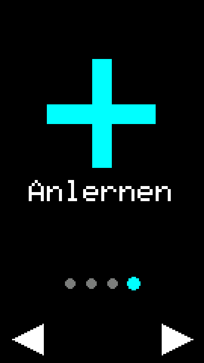 |
| **Zuordnung** — which sensor is on which wheel. | **Schwelle vorn** — the vehicle from above, the two front wheels lit. | **Schwelle hinten** — the same picture, the rear wheel lit. | **Anlernen** — find the sensors afresh. Last on purpose: it discards the assignment before it starts, so it should not be the page you reach by overshooting. |

## Zuordnung — which sensor is on which wheel

Three rows, each showing everything that tells the sensors apart, live: the engraved
number, the pressure, and the temperature. Squeeze a tyre and watch which row moves —
that is the wheel.

| | | |
|---|---|---|
| 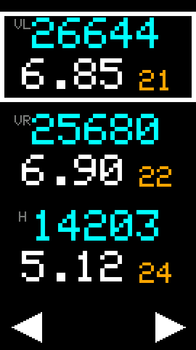 | 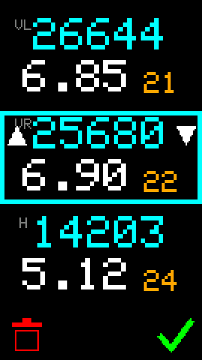 | 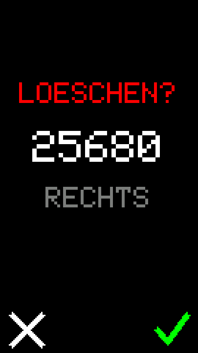 |
| A **white** frame is a selection. **A** and **B** move it down and up. | **A held** picks the entry up: the frame turns **cyan** and grows an arrow at each edge, over the button that moves it. Now A and B move the sensor itself, sliding it past the row it displaces. **A held** puts it down again. | **B held** on a picked-up entry deletes that sensor. The yes is on **A** — the other button — so no run of presses on one side can throw anything away. |

Thirty seconds without a press leaves, putting down anything that was picked up.

## Schwelle — the alarm pressure

Both values stay on screen while either is set, because front and rear run at different
pressures and you choose them in relation to each other. The one being edited is framed
and yellow.

| | |
|---|---|
| 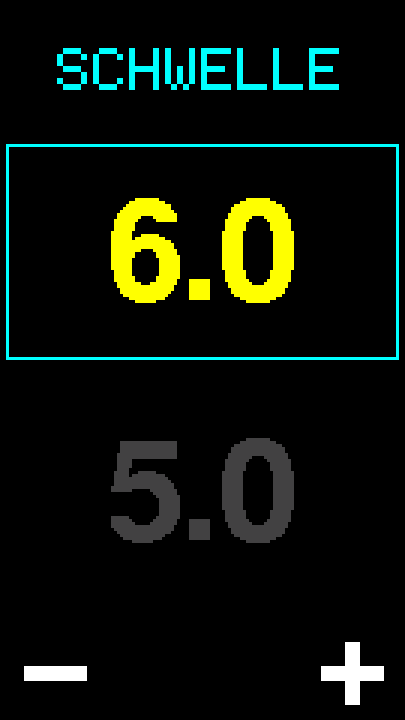 | 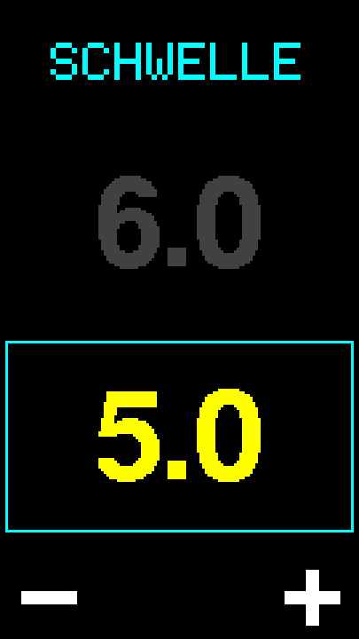 |
| **A** is +0.1 bar, **B** is −0.1, between 1.0 and 8.0. | Either button **held** stores the pair and leaves. There is no discard: both numbers are in front of you the whole time, so there is nothing to take back. |

Only lower limits are settable. An upper limit would fire every afternoon: a tyre
warmed from 15 to 35 °C reads more than half a bar higher with nothing wrong.

## Anlernen — finding the sensors

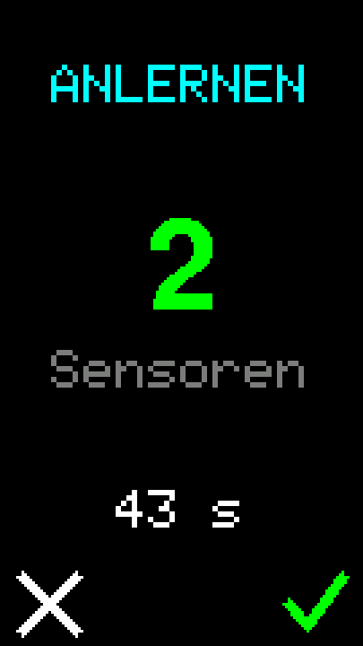

Spin each wheel first. A sensor sleeps about ten minutes after it stops moving, and a
sleeping sensor is indistinguishable from a broken one.

The window listens for a minute, or until three sensors have answered — whichever comes
first. The count climbs as they turn up. **A held** ends it early; **B held** abandons it.

Three or fewer is unambiguous and they are assigned around the vehicle without asking.
More than three — a neighbour's bike in the garage — cannot be resolved by any rule the
device could apply, so it asks instead of guessing, one wheel at a time.

Then go to **Zuordnung** and sort them into the right wheels.

 

## Without the vehicle

Hold **A** while the device starts. A one-pixel border is drawn round the whole panel
first — if a line is missing while the other three are there, the panel's window is
offset; if all four are drawn and one still cannot be seen, something is over the glass.
The corners decide it: clipping loses two, a bezel all four.

After that it runs on three invented sensors with realistic, quantised readings, from
an empty assignment — the learn window opens and the sensors turn up a second and a
half apart. One wheel loses about 0.15 bar a minute, so the slow-puncture warning
appears after roughly two. One battery starts low enough to show its warning at once.

Nothing is injected into the display: the readings are assembled into the same
notifications a real AIRSPY sends, so the averaging, the alarm hysteresis and the leak
reference are all exercised the way they would be on the road.
